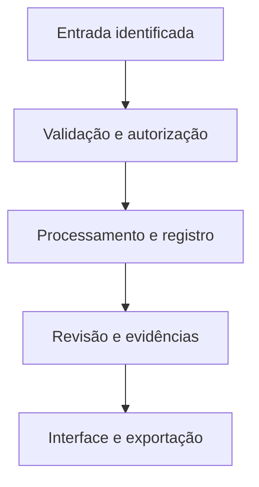

# Arquitetura proposta

## Importar

Sequências all-sky e metadados.

## Qualificar

Nuvens, Lua, exposição e calibração.

## Detectar

Máscaras revisadas e rastreamento.

## Prever

Baseline e modelo temporal comparados.

## Explicar

Relatório com evidências e limitações.

## Dados do domínio

- **Station / Calibration** — Local, lente, filtro, orientação, geometria e versão.
- **Frame / QualityFlag** — UTC, checksum, exposição, nuvens, Lua e exclusão.
- **Annotation / MaskVersion** — Blob, bubble, fundo, revisor e região inconclusiva.
- **Sequence / DatasetSplit** — Noite, estação, janelas e grupos de treino/validação/teste.
- **ForecastRun / ModelVersion** — Horizonte, entrada, probabilidade, baseline e parâmetros.
- **EvidencePackage / LLMReport** — Métricas verificadas, fontes, prompt, modelo e revisão.

## Contas e permissões

Sessão no servidor, autorização por papel e propriedade, arquivos privados por escopo e auditoria de mudanças. A interface nunca é a única barreira de acesso.
